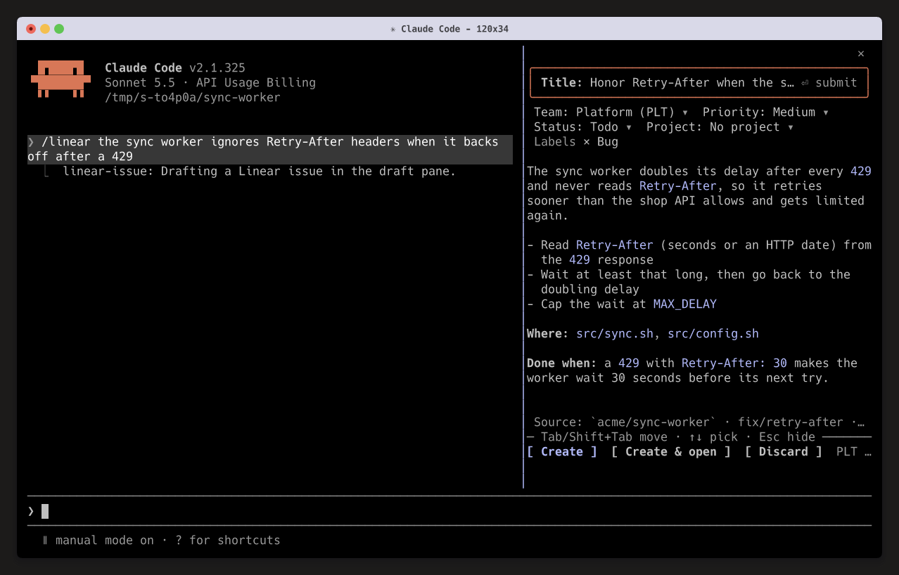
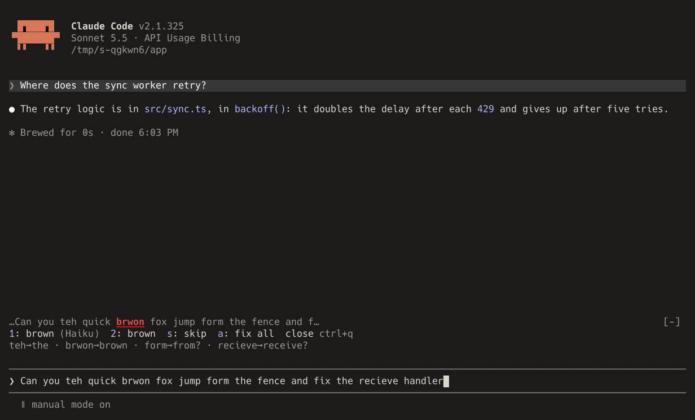
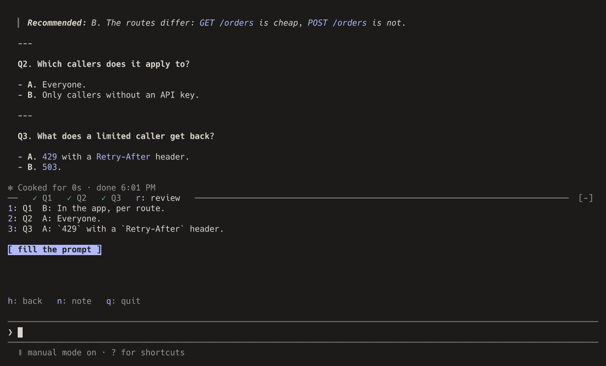

# agents

<!-- Generated by scripts/readme.ts (`just readme`) from plugins/*/README.md, skills/*/SKILL.md and docs/. Edit those, not this file. -->

Plugins for [Claude Code](https://claude.com/claude-code), for the
[pi](https://github.com/earendil-works/pi) coding agent, or for both, and agent skills for any
agent that reads them. On my own machines home-manager installs these same folders from this
flake, so what's published here is what I run.

Documentation, with a page per plugin and skill: **https://nickolaj-jepsen.github.io/agents/**

## Install

```bash
claude plugin marketplace add nickolaj-jepsen/agents
claude plugin install linear-issue@nickolaj-jepsen
claude plugin install answer@nickolaj-jepsen
claude plugin install spellfix@nickolaj-jepsen
```

The skills, all of them or one by its subpath, with [`npx skills`](https://github.com/vercel-labs/skills)
or as one Claude Code plugin:

```bash
npx skills add nickolaj-jepsen/agents
npx skills add https://github.com/nickolaj-jepsen/agents/tree/main/skills/land
claude plugin install skills@nickolaj-jepsen
```

The flake (`nix flake check`) tests each plugin against Claude Code from nixpkgs master, and my
machines against the version they ship. A marketplace install gets no such check, so a
Claude Code update can break one.

## Plugins

### [linear-issue](https://nickolaj-jepsen.github.io/agents/plugins/linear-issue/)

Turns a thought, or something Claude Code flagged, into a Linear issue you approve before it's filed.

[](https://nickolaj-jepsen.github.io/agents/plugins/linear-issue/)

### [spellfix](https://nickolaj-jepsen.github.io/agents/plugins/spellfix/)

Picks fixes for misspelled words in the prompt draft with hunspell and Haiku.

[](https://nickolaj-jepsen.github.io/agents/plugins/spellfix/)

### [answer](https://nickolaj-jepsen.github.io/agents/plugins/answer/)

A form for the round of questions or numbered pick list a turn ended on, which writes your reply into the prompt.

[](https://nickolaj-jepsen.github.io/agents/plugins/answer/)

More:

- [transcript-tweaks](https://nickolaj-jepsen.github.io/agents/plugins/transcript-tweaks/): Two changes to how the transcript reads. (pi)
- [claude-compat](https://nickolaj-jepsen.github.io/agents/plugins/claude-compat/): Claude Code habits in pi. (pi)
- [exa](https://nickolaj-jepsen.github.io/agents/plugins/exa/): `exa_search` and `exa_fetch` tools over Exa. (pi)
- [lsp](https://nickolaj-jepsen.github.io/agents/plugins/lsp/): Appends language-server errors to `edit` and `write` results. (pi)

In progress, and not ready for anyone else to use:

- [git-menu](https://nickolaj-jepsen.github.io/agents/plugins/git-menu/): Open the checkout's repository, branch, commit or pull request, hand it to an editor or file manager, and review the diff in tuicr. (Claude Code)
- [docfix](https://nickolaj-jepsen.github.io/agents/plugins/docfix/): Agents file doc suggestions instead of editing docs outside their change; you review them and hand the ones you want back to the agent. (Claude Code / pi)

## Skills

### Plan, build and ship

- [dispatch](https://nickolaj-jepsen.github.io/agents/skills/dispatch/): writes a small task's requirements, direction and references with minimal recon, not an implementation plan.
- [handoff](https://nickolaj-jepsen.github.io/agents/skills/handoff/): writes a finished plan up as a self-contained handoff for another agent.
- [land](https://nickolaj-jepsen.github.io/agents/skills/land/): takes finished work to landed commits or a PR, after checks and a review gate.
- [run-handoff](https://nickolaj-jepsen.github.io/agents/skills/run-handoff/): builds a handoff with one subagent and worktree per item, re-verifying each.

### Understand and decide

- [compare](https://nickolaj-jepsen.github.io/agents/skills/compare/): researches a choice or a whole category and says whether to pick, keep or build, with sourced evidence.
- [onboard](https://nickolaj-jepsen.github.io/agents/skills/onboard/): teaches you an unfamiliar project by running it and tracing one real action.

### Clean up

- [prune-churn](https://nickolaj-jepsen.github.io/agents/skills/prune-churn/): removes tests, docs and structure that must change whenever something else does.
- [prune-comments](https://nickolaj-jepsen.github.io/agents/skills/prune-comments/): cuts comments and docstrings down to the load-bearing why.

### Harnesses

Each starts the real program and drives it with keys, screenshots and logs.

- [agent-plugin-dev](https://nickolaj-jepsen.github.io/agents/skills/agent-plugin-dev/): the UI of a Claude Code mod or pi extension, with a house style, a shared kit and a driver that parks a real session on any screen.
- [dms-plugin-dev](https://nickolaj-jepsen.github.io/agents/skills/dms-plugin-dev/): DankMaterialShell plugins, in a headless sway.

### Utilities

- [mermaid](https://nickolaj-jepsen.github.io/agents/skills/mermaid/): renders the Mermaid diagrams in a markdown file to SVGs.
- [pricerunner](https://nickolaj-jepsen.github.io/agents/skills/pricerunner/): searches and compares Danish prices on PriceRunner.dk.

### Modified public skills

My variants of public skills. Prefer the originals.

- [avoid-ai-tropes](https://nickolaj-jepsen.github.io/agents/skills/avoid-ai-tropes/): finds AI writing tells in prose and rewrites them. Its catalog comes from [tropes.fyi](https://tropes.fyi) by [ossama.is](https://ossama.is).
- [grill-me](https://nickolaj-jepsen.github.io/agents/skills/grill-me/): the `/grill-me` entry point to `grilling`. Reworked from the latest version of [Matt Pocock's `grill-me`](https://github.com/mattpocock/skills).
- [grilling](https://nickolaj-jepsen.github.io/agents/skills/grilling/): interviews you about a plan in rounds; other skills call it. Reworked from the latest version of [Matt Pocock's `grill-me`](https://github.com/mattpocock/skills).

### In progress

Unfinished, and not ready for anyone else to use.

- [brainstorm](https://nickolaj-jepsen.github.io/agents/skills/brainstorm/): finds an approach for a goal that has none yet.
- [ideate](https://nickolaj-jepsen.github.io/agents/skills/ideate/): finds what is worth doing with a repo or one area of it, as ranked ideas with evidence, approaches or a sourced answer.
- [mine](https://nickolaj-jepsen.github.io/agents/skills/mine/): answers a question about how your agents have been working from past sessions, and improves what's behind it.
- [retro](https://nickolaj-jepsen.github.io/agents/skills/retro/): improves a skill, tool or doc from what bothered you in one agent session.
- [tour](https://nickolaj-jepsen.github.io/agents/skills/tour/): walks you through a PR or a stack of them, one PR at a time.
- [windows-vm](https://nickolaj-jepsen.github.io/agents/skills/windows-vm/): drives a libvirt Windows guest with screenshots, keys and PowerShell.

## Development

See [`docs/`](docs/) or the [developer pages](https://nickolaj-jepsen.github.io/agents/dev/); the source is at https://github.com/nickolaj-jepsen/agents.
